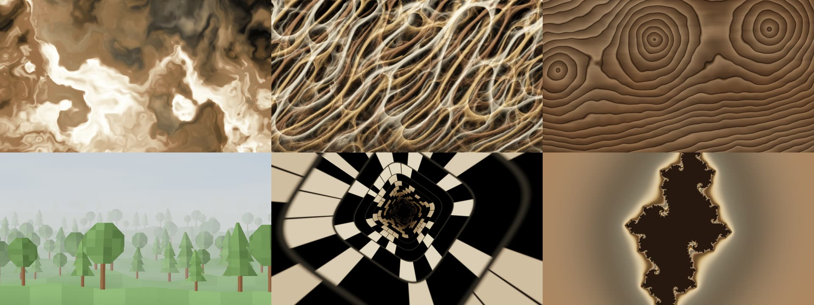

# show

Generative visuals for a wall or a projector, made to be left running for hours.
One HTML file, no dependencies, no build step, no network requests.

**Live: https://show.javierr.com**



## What it does

- **22 scenes in two groups.** Twelve calm ones (fluid, roots, mycelium, veins, coral, contours, wood, mud, sand,
  lichen, forest, video) and ten wild ones (tunnel, cavern, kaleido, acid, eyes, spiral, moiré, julia, lava, truchet).
- **Never repeats, never jumps.** Every scene is generated live and is as smooth in hour ten as in minute one.
- **Follows the music, or breathes by itself.** Turn on sound and it listens to any audio input. Bass moves the
  picture, volume adds light.
- **Your own video as a source.** Load a file and the video scene tints it and draws on top of it.
- **Projection mapping built in.** Up to eight surfaces, each with four draggable corners.
- **Two windows.** A control panel on the laptop and a clean output window for the projector. On a second computer
  with no panel, one click on the picture goes to the next scene.
- **Runs on modest hardware.** It measures its own frame time and lowers the detail until it runs smoothly.
- **Text.** Type a word and it appears on the picture; in the living scenes it grows.
- **MIDI.** Any controller, with a learn mode.

## Use it

Open https://show.javierr.com in Chrome and press `?` for the guide.

Offline, at a venue:

```sh
git clone https://github.com/JRC2307/show && cd show/web
python3 -m http.server
# open http://localhost:8000 in Chrome
```

Open it through `localhost` rather than as a file: the browser only allows sound input, and lets the two windows
talk to each other, on a real address.

| Key | Does |
|---|---|
| `1`–`9` `0` | calm scene |
| `shift` + number | wild scene |
| `q` `v` | forest, video |
| `←` `→` | color |
| `space` | next scene |
| `a` | change scene automatically |
| `b` | blackout |
| `p` | map |
| `h` `f` | hide panel, fullscreen |
| `?` | guide |

## Privacy

The page talks to nothing. Sound is analysed in the browser, a loaded video stays in the browser, and settings are
kept in the browser's local storage.

## Photosensitivity

No scene strobes or flashes, and that is a rule of the project. The wild scenes still move fast and use strong
contrast. Use the calm group if anyone in the room is sensitive to that.

## How it works

WebGL2. Each scene is one fragment shader drawn in a single pass. Roots, mycelium, veins and coral are a Physarum
(slime mold) simulation whose agents live on the GPU and move by transform feedback. Two wrapping clocks feed the
shaders so nothing drifts or snaps over long runs. Needs a browser with WebGL2; developed in Chrome.

Everything is in `web/index.html`. To add a scene, add one entry to `LOOKS`.

## How it was made

Built in conversation with Claude Fable 5.2 (Anthropic) through Claude Code, over a few rounds of feedback.

## License

MIT. See [LICENSE](LICENSE).
